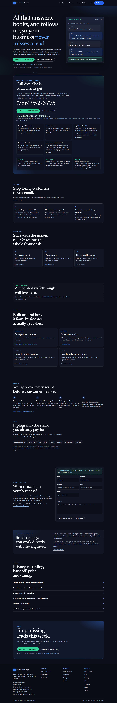

# Launchline Design

Marketing site for [Launchline Design](https://www.launchlinedesign.com), Myles Stute’s Miami studio for done-for-you AI. It replaces the old one-page web-design site.

The site is Astro and Tailwind, fully static, and deploys to Vercel. Instrument Sans and Newsreader are self-hosted from `public/fonts` (SIL Open Font License). No Google Fonts request.

## Office contact

These are live and linked throughout the site:

- Email: [Myles@launchlinedesign.com](mailto:Myles@launchlinedesign.com)
- Office phone: [(786) 229-4730](tel:+17862294730)
- Ava, the AI receptionist: [(786) 952-6775](tel:+17869526775)

Ava’s number lives in one constant, `DEMO_LINE`, in `src/data/site.ts`. It is not the office line. “Call Ava now” and “Hear it live” both dial `DEMO_LINE`.

## Run locally

Node.js 22.22 or newer.

```bash
npm install
npm run dev
```

The dev server listens on port **4731**.

```bash
npm run build
npm run preview
```

`npm run build` writes the static site to `dist/`.

## Configure the placeholders

Copy `.env.example` to `.env` for local builds. On Vercel, set the same variables in **Project → Settings → Environment Variables**, then redeploy. They are `PUBLIC_` variables, so they are baked in at build time. Changing them does nothing until the next build.

| Variable | What to put |
| --- | --- |
| `PUBLIC_DEMO_FORM_ENDPOINT` | Formspree endpoint, such as `https://formspree.io/f/xxxxxxxx`. The form POSTs `name`, `business`, `website`, `email`, `phone`, `notes`, and `source`, plus `_subject` and a `_gotcha` honeypot. A hidden `_next` is `https://www.launchlinedesign.com/thanks`. With JavaScript, a successful response also goes to `/thanks`. |
| `PUBLIC_CAL_LINK` | Cal.com event path only, such as `myles-stute/15min`. Not the full URL. When set, the contact page loads the Cal.com inline embed. |
| `PUBLIC_STREET_ADDRESS` | Optional. Leave blank to show Miami, FL and Miami-Dade only. |

The site builds and runs with none of these set. The demo form stays on the page, the submit button is disabled, and nothing is posted. Email and both phone lines still work. The contact page shows a call-or-email panel instead of a calendar iframe.

Also still open:

- A sample Loom embed on the homepage and the demo page.
- A lawyer’s pass on `src/pages/privacy.astro` and `src/pages/terms.astro` before treating them as the signed contract. Recording consent and SMS are flagged in the pages.
- A blog or guides section was not built. There are no articles yet, and an empty blog would be thin content.

The discovery call is **15 minutes**, matching the approved service menu (the earlier outline said 20).

## Deploy to Vercel

1. Push this repository to GitHub, GitLab, or Bitbucket if it is not already connected.
2. In Vercel, **Add New → Project** and import the repo.
3. Framework preset: **Astro**. Build command: `npm run build`. Output directory: `dist`. Install command: `npm install`.
4. Add the `PUBLIC_` variables above for Production (and Preview, if you want them there).
5. Deploy. Attach `launchlinedesign.com` and `www.launchlinedesign.com`. Canonical URLs use `https://www.launchlinedesign.com`.
6. After the first deploy, confirm `/sitemap-index.xml` and `/robots.txt` load, then submit the sitemap in Google Search Console.

No Vercel adapter is required. The site is static HTML. `vercel.json` sets the Astro framework, `npm run build`, output directory `dist`, clean URLs without a trailing slash, basic security headers, and a long cache on the font files.

GitHub Pages on `main` is the previous live site. Deploy this Astro build from the `astro-rebuild` branch, or from Vercel, and do not overwrite `main` until that cutover is intentional.

## Pages

- `/` Home
- `/ai-receptionist`
- `/automation`
- `/custom-ai`
- `/industries/home-services`
- `/industries/law-firms`
- `/industries/med-spas`
- `/industries/dental`
- `/demo`
- `/how-it-works`
- `/pricing`
- `/about`
- `/contact`
- `/privacy`
- `/terms`
- `/thanks` (noindex, excluded from the sitemap; form redirect target)

## Screenshots

Homepage, after `npm run preview`:




## Brand

Navy `#0C0F1A`, electric blue `#3B82F6` / `#60A5FA`, mint `#34D399`. Newsreader for headings, Instrument Sans for text. The mark is a blue rounded square with an L, and the wordmark is Launch**line** Design.
